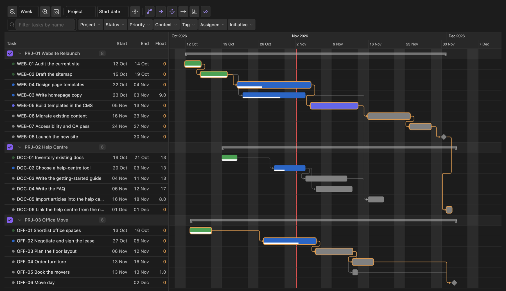
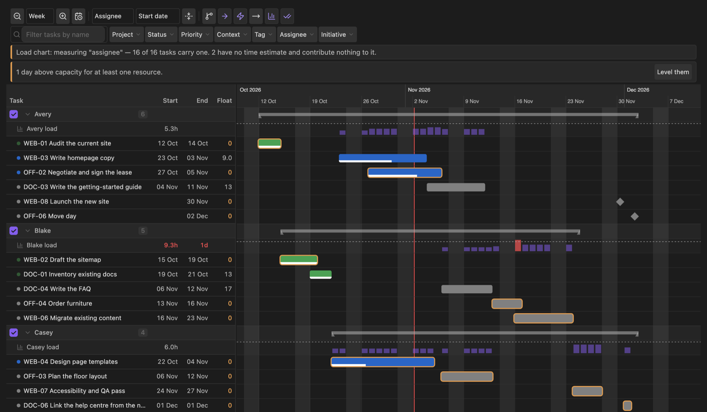
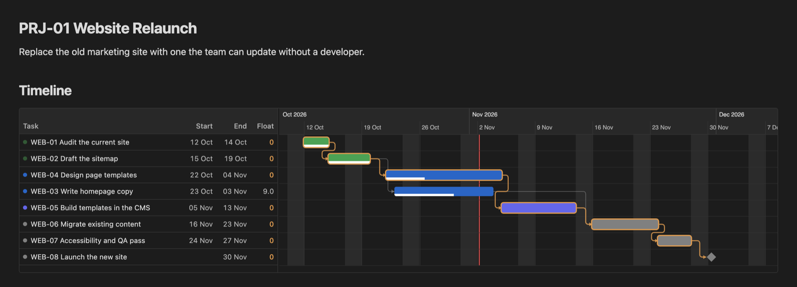

# TaskNotes Gantt

Gantt chart, critical path and resource planning for
[TaskNotes](https://github.com/callumalpass/tasknotes) projects in Obsidian.

TaskNotes gives every task a note, real dates and real dependencies. This plugin draws
the plan those fields already describe — and lets you change it by dragging.



## What it does

- **Three surfaces.** A Bases view that inherits any `.base` file's filters, a
  standalone tab covering the whole vault, and a `tngantt` block that draws a live
  chart inside any note.
- **Editing.** Drag to reschedule, drag ends to resize, Shift-drag to create
  dependencies. All four ICS relation types.
- **Critical path** with float, dependency-conflict detection, cycle reporting, and
  optional cascade — with one-click fixes for conflicts and circular chains.
- **Capacity.** A daily load histogram per group against per-resource capacity, and
  one-click levelling that pushes work off overloaded days without breaking a
  dependency.

  

- **Baselines** with variance, and progress from checklists, tracked time or status.
- **Filtering.** Facets for project, status, priority, context, tag, the resource
  property and your own TaskNotes user fields — an `initiative` field, say, to plan
  several related projects together. ANDed across facets, ORed within them.
- **Export** to SVG, PNG, CSV or Mermaid.
- **AI-operable.** A headless CLI and an MCP server over the same scheduling engine, so
  an agent can read the plan, propose changes, check what they would break, and write
  them — with a dry run by default and an undo for every write.
- **Safe by default.** Safe mode, confirmation for bulk changes, and undo on every
  write path.

Full keyboard control, pinch to zoom on touch, and a print stylesheet.

A project note can carry its own live timeline:

````markdown
```tngantt
project: Website Relaunch
zoom: week
```
````



The screenshots come from a vault of made-up projects that
`node scripts/demo-vault.mjs <folder>` builds, so you can try the plugin on the same
data.

## Documentation

| | |
| --- | --- |
| [User guide](docs/user-guide.md) | Reading the chart, editing, filtering, settings reference, troubleshooting |
| [Agent guide](docs/agent-guide.md) | Planning the vault from the CLI or MCP — written for the AI, and worth a read before you point one at your notes |
| [Tools reference](docs/tools-reference.md) | Every command, flag, tool argument, output shape and exit code |
| [Architecture](docs/architecture.md) | Module map, the data pipeline, and the invariants that must not break |
| [Development](docs/development.md) | Build, test, deploy to a vault, conventions, releasing |
| [TaskNotes integration](docs/tasknotes-integration.md) | Every assumption about TaskNotes, and what happens when one fails |
| [Backlog](docs/backlog.md) | Deferred work, and why it was deferred |
| [Changelog](CHANGELOG.md) | What changed in each version |
| [Contributing](CONTRIBUTING.md) | How to propose a change |
| [Security](SECURITY.md) | How to report a vulnerability, and what the plugin can and cannot touch |

## Planning with an AI

The chart's model — critical path, working-time arithmetic, capacity, conflict and
cycle detection — is also reachable outside Obsidian, so an AI agent can plan against
the same numbers you see on screen rather than re-deriving them from 160 markdown files
and getting it wrong.

The CLI and MCP server are not part of the plugin download — they run with Node, from
a clone of this repository:

```sh
git clone https://github.com/alin-morosanu/tasknotes-gantt && cd tasknotes-gantt
npm ci && npm run build

node bin/tng.mjs doctor    --vault ~/vault --project "PRJ-06"
node bin/tng.mjs schedule  --vault ~/vault --project "PRJ-06" --start 2026-05-04 --out p.json
node bin/tng.mjs validate  --vault ~/vault --project "PRJ-06" --file p.json
node bin/tng.mjs apply     --vault ~/vault --project "PRJ-06" --file p.json --write --undo-out undo.json
```

The same four capabilities are available over MCP. Register `bin/tng-mcp.mjs` with your
agent (see [the agent guide](docs/agent-guide.md)) and it gets `gantt_snapshot`,
`gantt_validate`, `gantt_apply` and `gantt_schedule`.

**Three things keep this safe rather than merely convenient:**

- **Nothing writes by default.** `apply` is a dry run until you pass `--write`, and
  `schedule` and `validate` never write at all.
- **Every write is reversible.** `apply` hands back the proposal that undoes it.
- **The agent has to check its own work.** `validate` reports what a change would break
  as well as what it would fix, and `apply` refuses a proposal that does not validate.

Two caveats worth knowing before you use it on notes you care about. The CLI runs
outside Obsidian, so it edits frontmatter directly rather than through the TaskNotes
API: `dateModified` is not maintained on this path, and Obsidian picks the change up
through its file watcher the way it would an edit from any external editor. And it is
worth trying against a copy of your vault first — `git init` a copy, run the change, and
read the diff.

## Requirements

- Obsidian 1.10.0 or later, for the Bases view API.
- TaskNotes 4.12 or later for editing. Earlier versions, or TaskNotes disabled, fall
  back to a read-only chart with a banner explaining why.

## Install

**From the community plugin browser** (once listed): **Settings → Community plugins →
Browse**, search for *TaskNotes Gantt*, install, and enable.

**Manually:** download `main.js`, `manifest.json` and `styles.css` from the
[latest release](https://github.com/alin-morosanu/tasknotes-gantt/releases/latest)
into `<vault>/.obsidian/plugins/tasknotes-gantt/`, then enable the plugin in
**Settings → Community plugins**. (`.obsidian` is the default name of the vault's
config folder; use yours if you have renamed it.)

TaskNotes must be installed and enabled for editing. Without it the chart is read-only.

## Versioning

Releases follow [Semantic Versioning](https://semver.org), and every change is recorded
in the [changelog](CHANGELOG.md) in [Keep a Changelog](https://keepachangelog.com)
format. While the version starts with `0.`, a minor bump (0.1 → 0.2) may need you to
adjust something, and the changelog says what; a patch bump (0.1.0 → 0.1.1) is always
safe to take.

## How it stores data

Inside Obsidian, fields TaskNotes owns — `scheduled`, `due`, `status`, `blockedBy` and
the rest — are only ever written through the TaskNotes API, so its caches,
`dateModified` bookkeeping and reverse-dependency handling all stay correct. The
headless CLI runs outside Obsidian and cannot use that API, so it edits the frontmatter
keys directly and leaves `dateModified` alone; see
[Planning with an AI](#planning-with-an-ai).

Fields this plugin adds — baselines — are written directly to task frontmatter under
configurable property names, so they stay readable and diffable, and survive if you
uninstall this plugin.

One thing to know: TaskNotes accepts two `blockedBy` shapes, and its own serializer
normalizes to the object form whenever it writes a task. So the first time you edit a
task that used the bare-string form, those entries are rewritten. No dependency is lost;
only the formatting changes, and it is TaskNotes' behaviour rather than this plugin's.
See [the integration doc](docs/tasknotes-integration.md#data-shapes-that-vary).

## Development

```sh
npm install
npm run dev      # watch build
npm test         # unit tests
npm run build    # typecheck + production bundle
```

Point `OBSIDIAN_VAULT` at a vault and every build deploys into it:

```sh
OBSIDIAN_VAULT=/path/to/scratch-vault npm run dev
```

Use a scratch vault — this plugin writes to task notes. See
[Development](docs/development.md) for the full setup, and
[Contributing](CONTRIBUTING.md) before opening a pull request.

## Privacy

The plugin runs entirely locally. It makes no network requests and collects no
telemetry, and neither does the CLI or the MCP server.

The MCP server is a local process that speaks to whatever agent you point at it. What
that agent then does with your task data is between you and it — a snapshot of a
108-task initiative is around 3,000 words of titles, dates and statuses, so decide
deliberately before handing it to a hosted model.

## License

MIT
